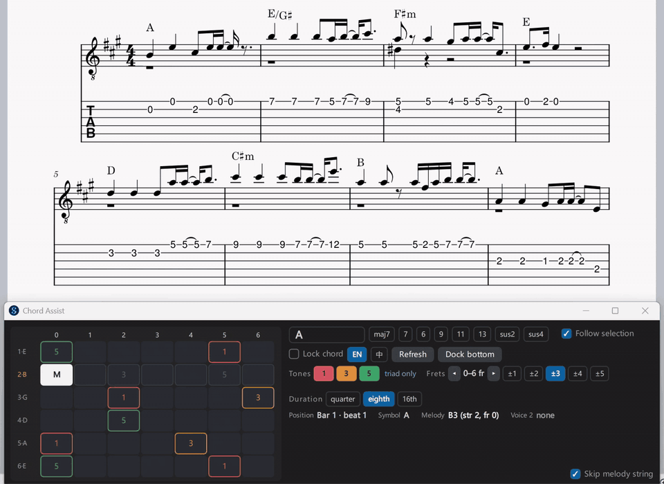

# Chord Assist

A MuseScore Studio 4 plugin for fingerstyle guitar arranging. Select a melody note and a panel docked under the score shows which tones of the current chord are available on the fretboard. Click a cell to write that note into voice 2 at the same beat; click it again to remove it.



## Features

- **Follows the score.** The panel tracks the selected note and reads the chord symbol in effect at that beat (add symbols with Ctrl+K). The chord can be edited or locked in the panel.
- **Fret window.** Shows a window of frets around the melody (±1 to ±5) plus the open strings. Chord tones are labelled by scale degree (1, 3, 5, ♭7 …); the melody note and its string are marked.
- **Write by clicking.** Each click writes one note into voice 2 of the selected staff with the string and fret pinned, so tablature stays correct. Several clicks at the same beat build a chord; one string, one note.
- **Duration.** Quarter, eighth (default) or sixteenth. Choosing a duration while a chord already exists at that beat rewrites it.
- **Keyboard navigation.** ← / → jump to the previous / next melody note; Shift+← / → move the fret window; Esc closes.
- **Docked panel.** A low, wide window that docks to the bottom of the MuseScore window. Every click is one undo step.
- **English / 中文 (Traditional) interface**, remembered between sessions.

## Requirements

MuseScore Studio 4.6 (developed and tested on 4.6.3, Windows). Works best on a guitar score with a linked tablature staff: select the melody on the TAB staff so the plugin knows the string and fret.

## Installation

1. Download or clone this repository.
2. Put the folder into MuseScore's plugins directory as `Plugins/ChordAssist` (`Documents\MuseScore4\Plugins` on Windows, `~/Documents/MuseScore4/Plugins` on macOS and Linux). `install.sh` (Linux, macOS) and `deploy-windows.ps1` or `win\install.bat` (Windows) do this for you.
3. In MuseScore: Home → Plugins → enable **Chord Assist**, then restart MuseScore.
4. Run it from Plugins → Chord Assist.

## Usage

1. Open a score with chord symbols and select a melody note (or rest).
2. Run Plugins → Chord Assist. The panel docks to the bottom of the window and shows the chord tones in the fret window.
3. Click cells to write notes into voice 2; click a filled cell to remove it. Use the duration chips to change the note value.
4. Press → to move to the next melody note and continue.

| Key | Action |
|---|---|
| ← / → | Previous / next melody note |
| Shift+← / → | Move the fret window |
| Esc | Close the panel |

## Project layout

```
ChordAssist.qml           Panel UI and MuseScore integration
core/theory.js            Chord symbol parsing → scale degrees
core/fretboard.js         Fretboard model, fret window, cell grid
core/i18n.js              Interface strings (English / Traditional Chinese)
core/instance.js          Single-window guard
core/shape.js, slots.js   Fingering suggestion and rhythm slots from v0.1; not used by the current panel
Probe.qml                 Environment probe: reports what the plugin API supports on your MuseScore
test/test.js              Tests for the core modules (node test/test.js)
```

`core/` has no MuseScore dependency, so the music theory and fretboard logic can be tested with plain Node.js.

## Notes

- Notes are written into voice 2 of the staff that holds the selected note; voice 1 is never edited.
- The chord symbol lookup searches backwards from the selected beat, so a symbol applies until the next one.
- Design notes from v0.1 (in Chinese, partly outdated) are kept in [docs/README-v0.1.zh.md](docs/README-v0.1.zh.md).
